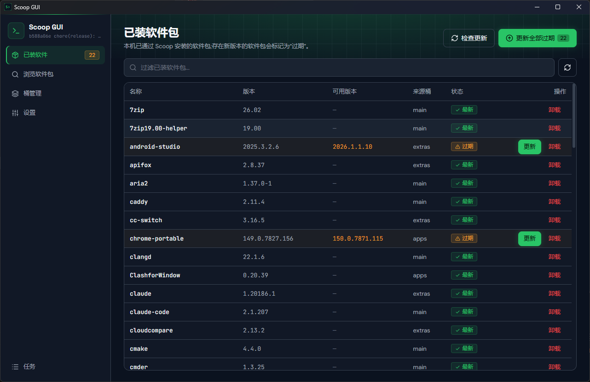

<div align="center">


# scoopUI

**A graphical desktop client for the [Scoop](https://scoop.sh) command-line package manager on Windows**

[](https://github.com/nvrenshiren/scoopUI/actions/workflows/ci.yml)
[](https://github.com/nvrenshiren/scoopUI/releases)
[](LICENSE)
[](https://github.com/nvrenshiren/scoopUI/releases)
[](https://tauri.app)
[](https://react.dev)

English | [简体中文](README.md)



</div>

---

scoopUI turns everyday `scoop` command-line workflows — browsing, searching, installing, uninstalling, updating packages, and managing buckets — into a point-and-click desktop experience. On first launch, if Scoop isn't installed yet, the app can walk you through a guided, parameterized run of the official install script. Built with **Rust (Tauri 2) + React 19 + shadcn/ui + Tailwind CSS v4** for a small install footprint and low memory usage.

## Features

- **Installed packages** — list view with outdated markers (diffed against `scoop status`), per-package update/uninstall, and one-click "update all outdated"
- **Browse & search** — every installable package across your added buckets, instant keyword filtering, one-click install
- **Package details** — `scoop info` key/value output plus action buttons that adapt to the package's current state
- **Bucket management** — list added buckets, browse Scoop's known-bucket catalog, add (including custom repo URLs) or remove buckets
- **Long-running job queue** — package and bucket operations plus guided Scoop installation run sequentially with live logs and cancellation; retry by starting the action again from its source page
- **Scoop settings** — manage supported Scoop configuration values; scalar values apply immediately and complex `private_hosts` is read-only
- **Guided first-run Scoop install** — detects whether `scoop` is available; if not, presents an editable form covering every parameter of the official `install.ps1` (ScoopDir / ScoopGlobalDir / ScoopCacheDir / Proxy / NoProxy / ProxyCredential / ProxyUseDefaultCredentials / RunAsAdmin), runs once confirmed, supports the UAC elevation path, and persists your settings locally for reinstalls
- **Bilingual (Chinese/English)** — choose on first launch, switch anytime from Settings with instant effect and persistence
- **Three themes** — dark / light / follow system, dark by default with the COHESION shadcn theme
- **Single instance** — relaunching focuses the existing window instead of opening a duplicate

## Installation

### Download the installer (recommended)

Grab the latest `*-setup.exe` from [Releases](https://github.com/nvrenshiren/scoopUI/releases) and run it.

When code changes are pushed to `master`, the release workflow increments the patch version and creates a versioned GitHub Release. Markdown-only and `docs/` changes do not trigger a release.

**Requirements**: Windows 10 / 11 (needs the [WebView2 Runtime](https://developer.microsoft.com/microsoft-edge/webview2/), preinstalled on Windows 11 and recent Windows 10 builds); installs per-user, no administrator rights required.

### Build from source

Prerequisites: [Rust](https://www.rust-lang.org/tools/install) 1.88+, [Node.js](https://nodejs.org) 20.19+ or 22.12+.

```bash
git clone https://github.com/nvrenshiren/scoopUI.git
cd scoopUI
npm ci
npm run tauri build -- -- --locked   # NSIS installer → src-tauri/target/release/bundle/nsis/
```

## Architecture

```
src/                 React 19 + TypeScript frontend (Vite 8)
  index.css          Tailwind v4 @theme: design tokens mapped to shadcn semantic variables
  api.ts             Tauri IPC wrapper; falls back to an in-browser mock when not running under Tauri
  store.ts           zustand global state: boot sequence, data refresh, job events, derived entity state
  i18n.ts            Full Chinese/English dictionary
  components/ui/     shadcn/ui components (Radix + cva, customized per the design system)
  pages/             Boot/guided-install · language picker · installed · browse · buckets · Scoop config · settings
  components/        Detail dialog · long-running task panel · empty/error states, etc.
src-tauri/           Rust backend
  src/scoop.rs       Locating scoop (multiple shim candidates) and spawning child processes (windowless, PATH injection)
  src/parse.rs       CLI table-text parsing (dash-separator rows anchor column boundaries), with real-output unit tests
  src/jobs.rs        Sequential job queue: state machine, line-by-line event stream, process-tree cancellation via taskkill
  src/installer.rs   install.ps1 runner generation (standard path and UAC-elevated path)
  src/settings.rs    Persistence to %APPDATA%\scoop-gui\config.json (language/theme/install config)
  src/commands.rs    All IPC commands (read commands run via spawn_blocking, write commands are enqueued)
```

Product requirements, business flows, and state-machine contracts live in [docs/prd/](docs/prd/); the design system is documented in [docs/design/systems/web.md](docs/design/systems/web.md).

## Development & checks

```bash
npm run tauri dev    # dev mode with hot reload (first Rust compile takes ~10 minutes)
npm run dev          # frontend only, mock data in the browser (no Rust needed)
npm run build
cargo fmt --manifest-path src-tauri/Cargo.toml --all -- --check
cargo clippy --manifest-path src-tauri/Cargo.toml --locked --all-targets -- -D warnings
cargo check --manifest-path src-tauri/Cargo.toml --locked
cargo test --manifest-path src-tauri/Cargo.toml --locked
```

## Tech stack

| Layer | Technology |
| --- | --- |
| Desktop framework | [Tauri 2](https://tauri.app) (Rust) |
| Frontend | [React 19](https://react.dev) + TypeScript + [Vite 8](https://vite.dev) |
| UI components | [shadcn/ui](https://ui.shadcn.com) ([Radix UI](https://www.radix-ui.com) + [Tailwind CSS v4](https://tailwindcss.com)) |
| State management | [zustand](https://zustand.docs.pmnd.rs) |
| Icons / notifications | [lucide-react](https://lucide.dev) / [Sonner](https://sonner.emilkowal.ski) |

## Contributing

Issues and PRs are welcome! See [CONTRIBUTING.md](CONTRIBUTING.md) (in Chinese, matching the project's existing docs) for dev setup, commit conventions, and the PR flow — English issues and PRs are welcome too.

## License

[MIT](LICENSE)

## Acknowledgments

- [Scoop](https://scoop.sh) — the Windows command-line package manager this project serves
- [Tauri](https://tauri.app) — a lightweight, secure desktop app framework
- [shadcn/ui](https://ui.shadcn.com) — an elegant React component toolkit
